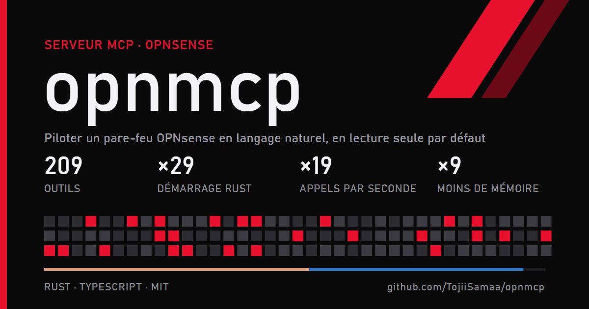

opnmcp est un serveur MCP pour les pare-feu OPNsense : un agent IA comme Claude peut consulter et modifier un pare-feu par son API, avec des garde-fous. Il expose 209 outils nommés par demande, en lecture seule par défaut, avec détection du risque de blocage et retour arrière. Le fork de Toji ajoute une version Rust, mesurée contre le TypeScript d'origine : démarrage 29 fois plus rapide et 9 fois moins de mémoire. Licence MIT.
